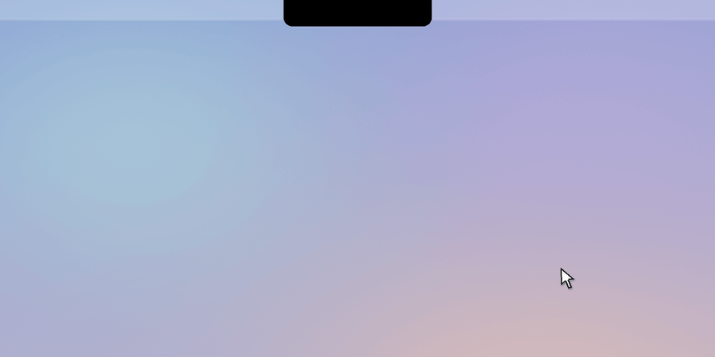

<p align="center">
  
</p>

<h1 align="center">Shelf</h1>

<p align="center">
  A native macOS shelf that lives in the notch — it peeks out when you hover or drag near it and unfolds into a black panel fused with the hardware notch. Stash files, text and screenshots, then drag them anywhere.<br>
  住在刘海里的 macOS 临时托盘——悬停或拖拽靠近时探头提示，展开成与硬件刘海融为一体的黑色面板；暂存文件、文字和截图，随用随拖走。
</p>

<p align="center">
  <a href="https://github.com/henryyu333/shelf/releases/latest/download/Shelf.dmg"></a>
</p>

<p align="center">
  Apple Silicon · macOS 13+ · Free and open source · <a href="#install">Install guide</a> · <a href="https://github.com/henryyu333/shelf/releases/latest">All downloads</a><br>
  Apple Silicon 芯片 · macOS 13 或以上 · 免费开源 · <a href="#安装">安装说明</a> · <a href="https://github.com/henryyu333/shelf/releases/latest">全部下载</a>
</p>

<p align="center">
  
</p>

<p align="center">
  <a href="LICENSE"></a>
  
  
</p>

<p align="center">
  <a href="#english">English</a> | <a href="#简体中文">简体中文</a>
</p>

---

<a id="english"></a>

## Install

Requires a Mac with Apple Silicon (M1 or later) running macOS 13 or later. Intel Macs are not supported.

1. Download **[Shelf.dmg](https://github.com/henryyu333/shelf/releases/latest/download/Shelf.dmg)**.
2. Open the downloaded file and drag **Shelf** onto the **Applications** folder.
3. Open Shelf from Applications. The first time, macOS will stop it — follow [First launch](#first-launch) below. You only do this once.
4. Shelf lives in the menu bar, not the Dock. Press `⌃⌥Space` to show the shelf.

Prefer a zip? Every release on the [Releases page](https://github.com/henryyu333/shelf/releases/latest) also has a `.zip` of the same version.

<a id="first-launch"></a>

### First launch: "Shelf Not Opened"

Shelf is free and not notarized by Apple, so macOS asks you to confirm it once. Only do this for a copy you downloaded from this repository.

**macOS 15 or later**

1. Double-click Shelf in Applications. When macOS says Shelf was not opened, click **Done** (not Move to Trash).
2. Open **System Settings → Privacy & Security** and scroll down to **Security**.
3. Next to "Shelf was blocked to protect your Mac", click **Open Anyway**.
4. Enter your password or use Touch ID, then click **Open Anyway** once more.

**macOS 13 or 14**

Control-click (or right-click) Shelf in Applications, choose **Open**, then click **Open** in the dialog.

From then on Shelf opens normally. If macOS ever says the app **is damaged**, don't bypass it — delete it and download it again from the Releases page. Apple's guide: [Safely open apps on your Mac](https://support.apple.com/102445).

### Optional

- **Start at login**: right-click the menu-bar icon → Settings → General → Open at login. The manual route still works: System Settings → General → Login Items → **+** → Shelf.
- **Uninstall**: right-click the menu-bar icon → Quit, then move Shelf from Applications to the Trash. To also delete your saved items, remove `~/Library/Application Support/Shelf/`.

## Features

- A transparent notch surface stays anchored at the top; hovering reveals a small black pill without moving the window
- Hover the notch and the shelf peeks; click the peeked notch and it unfolds into a pure-black panel fused with the hardware notch
- While the shelf is closed, live activity widens the notch into Dynamic-Island-style wings: battery/charging or a volume change shows a glyph left of the notch and text and/or a level bar right of it; clicking a wing unfolds the shelf. Music leaves the notch bare: hover for a compact player, or open the panel for the full card.
- Drag files near the notch and the shelf unfolds; drop onto the peeked pill to stash instantly
- While dragging, shake the pointer left and right to summon a floating basket beside the cursor — drop into it to stash
- Global hotkey ⌃⌥Space to show or hide the shelf; clicking outside collapses it back into the notch
- Drag files, folders, text and images in — and drag them out to any app
- Clipboard text history: keeps the last 30 items (30/100/300 is a menu choice), duplicates move to the top instead of creating copies; each capture remembers the app it came from
- ⌃⌥V opens the clipboard tab with a focused search field — type to filter, ↑/↓ to select, ⏎ copies and lands you back in the app you came from
- Pin any item (right-click → 置顶): pinned rows are marked, list first in both tabs, and are never evicted by the text limit, cleanup or clear-all
- Exclude an app from recording: right-click a clipboard item → never record from that app again (menu-bar → 剪贴板记录 toggles history entirely)
- Long text is shown as a short preview; copying or dragging keeps the complete text
- Screenshots and clipboard images land in the shelf automatically
- Skips passwords copied from password managers that mark them as private
- Contents persist across restarts
- Stores file references only — your files are never copied
- Select several items with ⌘ or ⇧ and drag them out together
- Right-click an item to open it, show it in Finder, Quick Look it, AirDrop it or copy its text or path
- Optional automatic cleanup of items older than 1, 7 or 30 days
- A Settings window (menu-bar icon → Settings) gathers every preference — start at login, notch drop protection, clipboard history and its size and excluded apps, cleanup, the notch island sources — and applies each one the instant you change it, exactly as the menu-bar submenus do
- Local-first: the only network access is an update check against GitHub Releases (on launch, then once a day; nothing about you is sent, and you can turn it off) — no telemetry, no cloud sync

## Usage
| Want to | Do this |
| --- | --- |
| Show or hide the shelf | Press `⌃⌥Space`, click the menu-bar icon, or hover the notch and click the peeked pill |
| Peek at the shelf | Move the pointer onto the notch (no drag needed) — it bulges out; click it to unfold |
| Expand from live status | Click the wings the notch shows while the battery changes or you adjust the volume — they unfold the shelf like the peeked pill |
| Control what is playing | Hover the notch: the peeked pill is a compact player (cover, title, play/pause). The card at the top of the open panel adds previous/next, progress and time remaining |
| Turn the notch sources on or off | Settings → Notch island, or right-click the menu-bar icon → Notch island (刘海岛): battery and charging (电量与充电) and volume (音量) switch their wings, while now playing (正在播放) switches the compact player and the panel card; each applies at once |
| Stash what you're dragging | While dragging anything, move near the notch — the shelf expands instantly; you can also drop right onto the peeked notch |
| Summon the drop basket | While dragging, shake the pointer left and right — a basket card appears beside the cursor; drop onto it |
| Send files or text to the shelf | Right-click selected items in Finder → Services/Quick Actions → "添加到 Shelf" (Add to Shelf); or select text in any app → app menu → Services → "添加到 Shelf" |
| Drag an item out | Drag it from the shelf into the target app |
| Copy a text item back | Click it once, then paste (`⌘V`) anywhere |
| Remove an item | Click the × on its right; file references never delete the original file |
| Select several items | ⌘-click to add or remove one, ⇧-click to select a range |
| Drag several items out | Select them, then drag any one of them |
| Switch between all items and clipboard captures | Click "Shelf" (托盘) or "Clipboard" (剪贴板) in the panel header |
| Search clipboard captures | Press `⌃⌥V` (or the Clipboard tab): type to filter — ↑/↓ selects, ⏎ copies and collapses back to your app, `Esc` clears the search then collapses |
| Pin an item | Right-click it → Pin (置顶); pinned rows show a pin mark and are never evicted by limits, cleanup or Clear |
| Stop recording an app | Right-click a clipboard item → Stop recording this app (不再记录来自「app」的内容); it lands in `settings.json`'s `excludedApps` |
| More actions | Right-click an item: open, show in Finder, Quick Look, AirDrop, copy, pin, remove |
| Quick Look | Select files or images and press Space; Space or `Esc` closes it |
| Clipboard history on/off and its size | Right-click the menu-bar icon → Clipboard History (剪贴板记录): the check item toggles recording live; the radio items cap stored texts at 30/100/300 |
| Change every preference in one window | Right-click the menu-bar icon → Settings: one window for start at login, notch drop protection, clipboard history and its size, excluded apps, cleanup, the notch island sources, the shortcuts and the data folder — each control applies at once and the menu-bar submenus keep showing the same state |
| Record from an app again | Settings → Clipboard → Excluded apps → Remove next to the app (apps are still added from an item's right-click menu) |
| Start Shelf at login | Settings → General → Open at login (macOS 13+); if it cannot be registered the reason shows under the switch, and the manual System Settings login item still works |
| See where your data lives | Settings → Open data folder opens `~/Library/Application Support/Shelf/` in Finder |
| Clean up old items | Right-click the menu-bar icon, choose the automatic cleanup period |
| Clear all items | Click Clear (清空) in the header — removes everything except pinned items (their saved images stay); file references never delete the original file |
| Collapse the shelf | Press `⌃⌥Space`, `Esc`, the collapse button, or click anywhere outside it |
| Turn on notch drop protection (optional) | Settings → General → Notch drop protection → Turn on… (or right-click the menu-bar icon and choose the notch drop protection item), then allow Shelf in System Settings; turn it on again after each update |
| Check for updates | Right-click the menu-bar icon → 「检查更新…」; when a new version exists the menu shows 「安装更新（vX）…」 and the shelf footer says so — installing happens only when you choose it; the daily background check is toggled in Settings → General → 「自动检查更新」 |
| Quit Shelf | Right-click the menu-bar icon → Quit |

## Privacy

Everything stays on your Mac: no telemetry, no cloud sync. The single exception is update checks: while enabled (default), Shelf queries this repository's latest GitHub release once shortly after launch and then once a day; the only data it sends is the app version in the standard User-Agent header (e.g. `MyGo/0.5.5 Shelf/1.0.8`) — no personal data, no identifiers. Turn it off in Settings → General → 「自动检查更新」 or with `"autoCheckUpdates": false` in `settings.json`; right-clicking the menu-bar icon → 「检查更新…」 always works on demand. When a new version is found, a notice appears in the shelf footer and an 「安装更新（vX）…」 item in the menu-bar menu — nothing downloads until you choose it. Text history is stored in plaintext at `~/Library/Application Support/Shelf/`, so avoid copying secrets you don't want recorded there.

## Build from source

Requires Go 1.27 or later and Xcode Command Line Tools:

```sh
go run github.com/egoist/mygo/cmd/mygo build
```

The packaged `Shelf.app` and a `.dmg` land in a `darwin-arm64` subfolder under the output directory configured in `mygo.json`.

## Docs

- [docs/MANUAL.zh-CN.md](docs/MANUAL.zh-CN.md) — full user manual (in Chinese)

## License

MIT — see [LICENSE](LICENSE).

---

<a id="简体中文"></a>

## 安装

需要 Apple Silicon 芯片（M1 或更新）的 Mac，系统 macOS 13 或以上。不支持 Intel 芯片的 Mac。

1. 下载 **[Shelf.dmg](https://github.com/henryyu333/shelf/releases/latest/download/Shelf.dmg)**。
2. 打开下载好的文件，把 **Shelf** 拖到 **Applications（应用程序）** 文件夹上。
3. 从“应用程序”里打开 Shelf。第一次打开会被系统拦下，按下面的[第一次打开](#第一次打开)操作即可，只需要做一次。
4. Shelf 住在屏幕顶部的菜单栏里，不在 Dock 上。按 `⌃⌥Space` 打开托盘。

想要 zip 压缩包？[Releases 页面](https://github.com/henryyu333/shelf/releases/latest)的每个版本里也有同一版本的 `.zip`。

<a id="第一次打开"></a>

### 第一次打开：提示“未打开 Shelf”

Shelf 是免费软件，没有经过 Apple 公证，所以 macOS 会让你确认一次。请只对从本仓库下载的版本这样做。

**macOS 15 或更新**

1. 在“应用程序”里双击 Shelf。系统提示未打开时，点 **完成**（不要点“移到废纸篓”）。
2. 打开 **系统设置 → 隐私与安全性**，往下滚动到 **安全性**。
3. 在“已阻止 Shelf 以保护 Mac”旁边，点 **仍要打开**。
4. 输入开机密码或用触控 ID 确认，再点一次 **仍要打开**。

**macOS 13 或 14**

在“应用程序”里按住 Control 点按（或右键点按）Shelf，选 **打开**，再在弹窗里点 **打开**。

之后就能正常打开了。如果系统提示 App **已损坏**，不要绕过，删掉后从 Releases 页面重新下载。Apple 官方说明：[在 Mac 上安全地打开 App](https://support.apple.com/zh-cn/102445)。

### 可选

- **开机自动启动**：右键菜单栏图标 → 设置… → 「开机时自动启动」。手动方式依然可用：系统设置 → 通用 → 登录项 → 点 **+**，选择 Shelf。
- **卸载**：右键菜单栏图标 → 退出 Shelf，再把“应用程序”里的 Shelf 移到废纸篓。如果连保存的内容也要删除，删掉 `~/Library/Application Support/Shelf/` 文件夹。

## 功能

- 刘海附近常驻透明接收区，悬停只改变胶囊画面，不再反复移动或缩放窗口
- 悬停刘海即探头，单击探头展开成与硬件刘海融为一体的纯黑面板
- 收起时刘海可以显示实时状态：电量与充电、音量变化会让黑色外壳向两侧展开成“岛翼”——左侧图标、右侧文字或电平条；单击岛翼即展开托盘。播放音乐时刘海保持干净：悬停探头是一枚紧凑播放器（封面、标题、播放/暂停），展开面板顶部是带上一首/下一首、进度与剩余时间的完整卡片
- 拖着内容靠近刘海时托盘会探头并展开；也可以直接拖到探头胶囊上松开
- 拖拽中左右快速摇晃指针，光标旁会唤出一个悬浮篮子——拖到上面松开即暂存
- 全局快捷键 ⌃⌥Space 随时显示或收起；点击托盘外任意处自动缩回刘海
- 文件、文件夹、文字、图片都可以拖进来，再拖到任意应用
- 剪贴板文字历史：默认保留 30 条（菜单栏可改 30/100/300），重复内容移到顶部而不新增条目；每条记录记住复制它的应用
- 按 `⌃⌥V` 打开剪贴板页并聚焦搜索框——输入即筛选，`↑`/`↓` 选择，`⏎` 复制后收起并落回你原来的应用
- 右键任意项目可以置顶：置顶行带图钉标记、在两个标签页都排最前，不受文字限额、自动清理和“清空”影响
- 按应用排除记录：右键剪贴板条目 → “不再记录来自该应用的内容”；菜单栏图标 → “剪贴板记录”可以整体开关
- 长文字只缩短列表摘要，复制和拖出仍保留完整正文
- 截图和剪贴板图片自动进入托盘
- 密码管理器标记为隐私的密码不会被记录
- 重启后内容保留
- 只记录文件引用，绝不复制你的文件
- 按住 ⌘ 或 ⇧ 多选，一次拖出多个
- 右键项目可以打开、在 Finder 中显示、快速查看、隔空投送、复制文字或路径
- 可选自动清理超过 1 天、7 天或 30 天的内容
- 设置窗口（右键菜单栏图标 → 设置…）集中全部偏好：开机时自动启动、刘海拖放保护、剪贴板记录与条数、排除的应用、自动清理、刘海岛来源；每项改完立即生效，与菜单栏子菜单用的是同一套设置
- 本地优先：唯一的网络请求是向 GitHub Releases 检查新版本（启动后不久一次，之后每天一次；不发送任何个人信息，可在设置中关闭）——无遥测、无云同步

## 使用

| 想做什么 | 操作 |
| --- | --- |
| 显示或收起托盘 | 按 `⌃⌥Space`、单击菜单栏图标，或悬停刘海后单击探头胶囊 |
| 探头预览 | 空手把指针移到刘海上——它会向下鼓出；单击探头胶囊即展开 |
| 从实时状态展开 | 电量变化或调节音量时刘海会向两侧展开“岛翼”，单击任一岛翼即展开托盘（与单击探头胶囊相同） |
| 控制正在播放 | 悬停刘海，探头胶囊是一枚紧凑播放器（封面、标题、播放/暂停）；展开面板顶部的卡片还有上一首/下一首、进度与剩余时间 |
| 刘海岛开关 | 设置… → 「刘海岛」，或右键菜单栏图标 → 「刘海岛」：勾选「电量与充电」「音量」启停对应岛翼；「正在播放」启停探头播放器与面板卡片，立即生效 |
| 暂存正在拖的内容 | 拖着任何东西靠近刘海触发区，托盘瞬间展开；也可以直接拖到探头刘海上松开 |
| 唤出暂存篮 | 拖拽中左右快速摇晃指针，光标旁出现篮子卡片；拖到上面松开即可 |
| 从 Finder 或服务菜单收进托盘 | 在 Finder 右键选中的文件或文件夹 → 服务/快速操作 → “添加到 Shelf”；或在任意应用选中文字 → 应用菜单 → 服务 → “添加到 Shelf” |
| 拖出项目 | 从托盘中拖住该项，到目标应用中松开 |
| 把文字复制回来 | 单击该文字项，然后在任意应用中粘贴（`⌘V`） |
| 移除项目 | 点击该项右侧的 ×；文件引用不会删除原文件 |
| 选中多个项目 | 按住 `⌘` 单击逐个选，按住 `⇧` 单击选一段 |
| 一次拖出多个 | 选中后拖住其中任意一个 |
| 更多操作 | 右键项目：打开、在 Finder 中显示、快速查看、隔空投送、复制、置顶、移除 |
| 切换全部内容 / 剪贴板记录 | 点面板头部的「托盘」或「剪贴板」 |
| 搜索剪贴板内容 | 按 `⌃⌥V`（或剪贴板页）输入筛选——`↑`/`↓` 选择，`⏎` 复制并收起回到原应用，`Esc` 先清空搜索再收起 |
| 置顶项目 | 右键 → 「置顶」；置顶行带图钉标记，不被限额、清理和「清空」移除 |
| 不再记录某个应用 | 右键剪贴板条目 → 「不再记录来自「应用」的内容」（写入 `settings.json` 的 `excludedApps`） |
| 剪贴板记录开关与条数 | 右键菜单栏图标 → 「剪贴板记录」：「记录剪贴板」即时开关；「保留 30/100/300 条」改文字上限 |
| 在一个窗口里改全部设置 | 右键菜单栏图标 → 设置…：开机时自动启动、刘海拖放保护、剪贴板记录与条数、排除的应用、自动清理、刘海岛来源、快捷键与数据文件夹；每个控件改完立即生效，菜单栏子菜单同步显示同样状态 |
| 恢复记录某个应用 | 设置… → 剪贴板 → 排除的应用 → 该行右侧「移除」（加入列表仍用条目的右键菜单） |
| 开机自动启动 | 设置… → 通用 → 开机时自动启动（macOS 13+）；注册失败时原因就显示在开关下方，手动加登录项的方式依然可用 |
| 查看数据文件夹位置 | 设置… → 打开数据文件夹，会在 Finder 里打开 `~/Library/Application Support/Shelf/` |
| 快速查看 | 选中文件或图片后按空格；再按空格或 `Esc` 关闭 |
| 自动清理旧内容 | 右键菜单栏图标 → 自动清理，选择期限 |
| 清空全部项目 | 点击托盘顶部的“清空”——移除置顶以外的全部项目（置顶项连同它们的截图保留）；文件引用不会删除原文件 |
| 收起托盘 | 按 `⌃⌥Space`、`Esc`、“收起”，或点击托盘外任意处 |
| 开启刘海拖放保护（可选） | 右键菜单栏图标 → 开启刘海拖放保护…，再在系统设置里打开 Shelf；每次更新后重新开启一次 |
| 退出 Shelf | 右键菜单栏图标 → 退出 Shelf |
| 检查更新 | 右键菜单栏图标 → 「检查更新…」；发现新版本时托盘底部提示、菜单出现「安装更新（vX）…」，只有你选择后才会下载安装；每天一次的后台检查可在 设置… → 通用 → 「自动检查更新」关闭 |

## 隐私

一切都在本机：无遥测、无云同步。唯一的网络请求是自动更新检查：默认开启时，Shelf 在启动后不久向本仓库 GitHub 的最新 Release 查询一次，之后每天一次；请求只带一个标准的 User-Agent 头（应用名与版本，如 `MyGo/0.5.5 Shelf/1.0.8`），不携带任何个人信息或标识。可以在 设置… → 通用 → 「自动检查更新」关闭，或把 `settings.json` 里的 `"autoCheckUpdates"` 改成 `false`；关闭后仍可用右键菜单的「检查更新…」手动查询。发现新版本时只在托盘底部和菜单里提示，不会自动下载。文字历史以明文保存在 `~/Library/Application Support/Shelf/`，不希望被记录的密码、验证码等内容请先退出 Shelf 再复制。

## 从源码构建

需要 Go 1.27 或以上，以及 Xcode Command Line Tools：

```sh
go run github.com/egoist/mygo/cmd/mygo build
```

打包好的 `Shelf.app` 和 `.dmg` 在 `mygo.json` 配置的输出目录下的 `darwin-arm64` 子文件夹中。

## 文档

- [docs/MANUAL.zh-CN.md](docs/MANUAL.zh-CN.md) — 完整中文使用手册（含日常使用、数据位置、开机启动、修改快捷键）

## 许可

MIT — 见 [LICENSE](LICENSE)。
